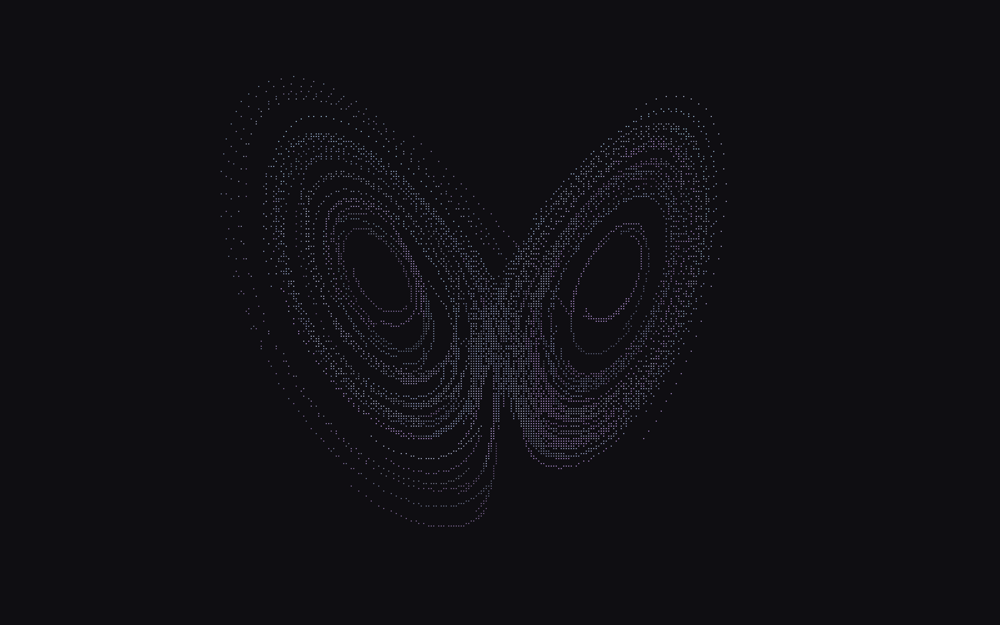
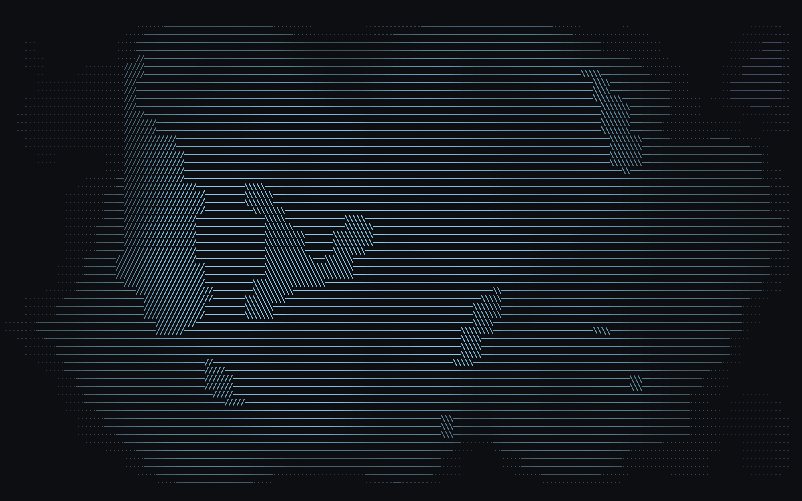
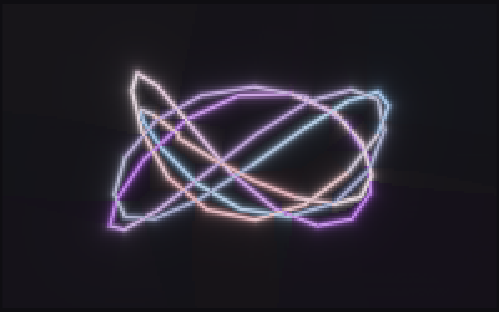

# Vibe

Fun lil rust CLI music visualiser for linux using ratatui :>

Vibe has 100 visualisers so far, and it fits your terminal colours perfectly!





## Cargo

```sh
cargo run --release
cargo build --release
./target/release/vibe
```

## Nix

Run without installing:

```sh
nix run git+https://tangled.org/sigilzero.dev/vibe
```

Install into your user profile:

```sh
nix profile add git+https://tangled.org/sigilzero.dev/vibe
vibe
```

## Usage

```sh
vibe --scene "Julia"
vibe --list
vibe --list-audio
vibe --demo
vibe --help
```

## Menu

`m` opens the menu. Scenes → Visualisation picks a scene; `/` searches and `f`
favourites the selected scene. Scenes also has filters, playlists, and
auto-advance.

Auto-advance can be off, follow phrases, or run on a timer. The interval or
fallback is set in seconds. Advance within offers all scenes, favourites, or
the active playlist when those exist.

## Audio

By default Vibe captures the output monitor of the default sink. Microphone
capture is opt-in.

```sh
vibe --list-audio
vibe --check-audio 3
vibe --audio-target auto_null
vibe --audio-source microphone
```

`--audio-source` accepts `auto`, `pipewire`, `pulse`, `microphone`, `command`,
or `file`. For raw PCM:

```sh
vibe --audio-source command \
  --audio-command 'parec --format=float32le --rate=48000 --channels=2 --device=@DEFAULT_MONITOR@'
vibe --audio-source file --audio-file track.raw
```

Raw PCM defaults to `f32le`, 48 kHz, stereo. Override it with
`--audio-format s16le|s32le`, `--audio-rate`, and `--audio-channels`.

## Display

```sh
vibe --fps 30
vibe --color-depth ansi256
vibe --glyphs ascii
vibe --follow-theme
```

## Config

All settings live in a config file and are editable from the in-app menu
(press `m`). CLI flags seed the in-memory config for the session and are not
persisted.

Config: `$XDG_CONFIG_HOME/vibe/config.toml`, or
`~/.config/vibe/config.toml`. Override with `--config PATH`.

## State

Remembers the last visualiser on normal exit. `--scene` overrides it.
State: `$XDG_STATE_HOME/vibe/state.toml`, or
`~/.local/state/vibe/state.toml`. The pre-state.toml `last-scene` file is
migrated automatically.

## Keys

- `←` / `→`: switch visualiser; in the menu, back / open or change a value
- `m`: open / close menu; `Esc`: back / close
- `↑` / `↓`: move
- `Enter`: select or edit
- `/`: search scenes; `f`: favourite the selected scene
- `q` / `Ctrl-C`: quit
